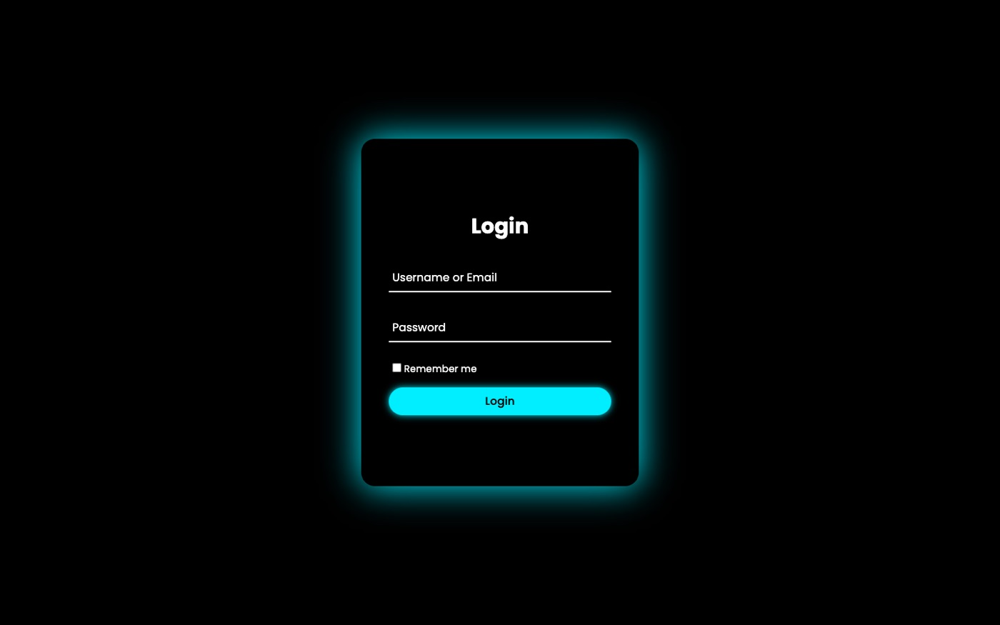

# GraphQL Profile

**Your Reboot01 profile, from the school's GraphQL API: level, audit ratio, skills and audits.**

    

[**Live demo**](https://graph-ql-coral-eta.vercel.app)

## Features

### 🔐 Secure Authentication
- User-friendly login interface
- Secure token-based authentication
- Remember me functionality

### 📊 Profile Dashboard
- **User Information**
  - Display of user's full name
  - Clean and modern profile header

- **Level Progress**
  - Dynamic SVG-based level indicator
  - Visual representation of current level
  - Circular progress indicator
  - Real-time level updates

### 📈 Statistics Visualization
1. **Audit Activity**
   - Visual representation of audits done vs. received
   - Real-time audit ratio calculation
   - Interactive progress bars

2. **Skills Radar**
   - Beautiful radar chart showing skill proficiency
   - Categories include:
     - Programming
     - Go
     - Front-End
     - JavaScript
     - HTML
     - Back-End
   - Percentage-based skill visualization

3. **Audit Status Tracking**
   - Organized view of all audits:
     - ✅ Passed Audits
     - ❌ Failed Audits
     - ⚠️ Expired Audits
     - 📝 To-Do Audits
   - Real-time status updates

## Technical Stack

- **Frontend**
  - HTML5
  - CSS3 with modern animations
  - Vanilla JavaScript
  - SVG for dynamic level visualization
  - Chart.js for data visualization

- **Backend Integration**
  - GraphQL API integration
  - JWT-based authentication
  - Real-time data fetching

## UI Features

- 🌙 Dark theme with neon accents
- 📱 Fully responsive design
- ✨ Smooth animations and transitions
- 📊 Interactive charts and graphs
- 🎨 Modern and clean interface
- 🔄 Dynamic SVG animations

## Responsive Design

The application is fully responsive and works seamlessly across:
- Desktop screens
- Tablets
- Mobile devices

## Security Features

- Secure token storage
- Protected routes
- Session management
- Automatic logout functionality

## Getting Started

1. Clone the repository
2. Open `index.html` in your browser
3. Log in with your Reboot01 credentials
4. Explore your personalized dashboard

## License

This project is part of Reboot01's curriculum and follows their licensing guidelines.

---

Built by **Hasan Abdulla** · [github.com/hx03s](https://github.com/hx03s) · Bahrain 🇧🇭

